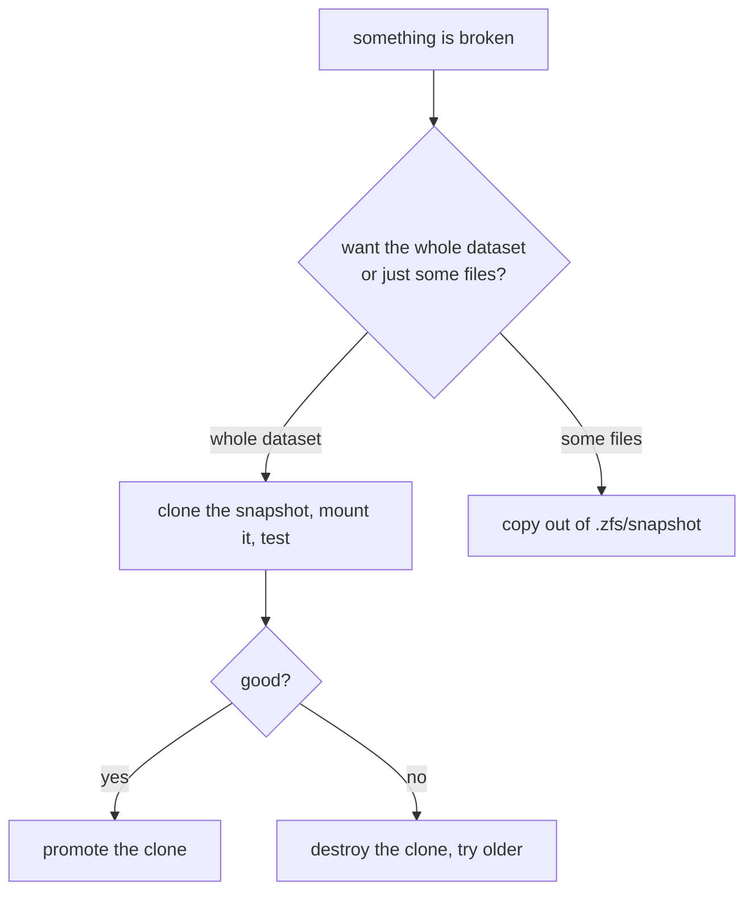

# Snapshots

<span class="status status-draft">draft</span>

How snapshots get named, kept and pruned here — and what to actually do when something needs recovering.

The commands themselves are in the [zfs quick start](../../quickstarts/zfs.md). This page is the policy.

## Prerequisites

- Pool healthy: `zpool status -v` clean before trusting anything
- `snapdir=hidden` on user datasets (the default)
- Free space headroom. Snapshots hold blocks; a full pool breaks everything downstream

## Why it's built this way

Snapshots are instant and nearly free, which makes them easy to over-trust. Two rules drive all of it:

1. **Snapshots are not backups.** They live on the same pool, on the same disks, in the same box. Losing the pool loses every snapshot with it.  Offsite copies come from [borg](../../quickstarts/borgbackup.md) or `zfs send`.
2. **A snapshot you can't find is a snapshot you don't have.** Naming is deterministic and greppable, so recovery never depends on remembering what you called something six weeks ago.

Tiers exist so that "oops, five minutes ago" and "that broke last month" both have an answer without keeping a year of hourly snapshots.

## Naming

```
auto_YYYY-MM-DD_HHMM_<tier>      # automated
manual_YYYY-MM-DD_<reason>       # before a risky change
keep_YYYY-MM-DD_<reason>         # held, prune must not touch it
```

All three sort lexically, so `zfs list -t snapshot` is already chronological and the oldest is at the top.

## Retention

| Tier | Keep | Covers |
|------|------|--------|
| hourly | 24 | fat-fingered deletes, bad edits |
| daily | 14 | "that broke last week" |
| weekly | 8 | "that broke last month" |
| monthly | 12 | "when did this change" |

Past a year, the offsite copy is the answer, not more snapshots.

## Automation

Sanoid, because snapshotting and pruning live in one config:

```ini
# /etc/sanoid/sanoid.conf
[tank/data]
  use_template = production
  recursive = yes

[template_production]
  hourly = 24
  daily = 14
  weekly = 8
  monthly = 12
  autosnap = yes
  autoprune = yes
```

```bash
systemctl enable --now sanoid.timer
```

`zfs-auto-snapshot` is the alternative — it drives off `com.sun:auto-snapshot` user properties per dataset. Simpler to reason about, less flexible to prune.

Datasets that shouldn't be snapshotted at all (scratch, VM images with their own scheme):

```bash
zfs set com.sun:auto-snapshot=false tank/scratch
```

## Holding what matters

Anything held survives prune regardless of tier:

```bash
zfs snapshot tank/data@keep_2026-10-25_preupgrade
zfs hold keep tank/data@keep_2026-10-25_preupgrade
```

Release it once the change has proven itself:

```bash
zfs release keep tank/data@keep_2026-10-25_preupgrade
```

Check what's held when a destroy refuses — `zfs holds -r tank`.

## Recovery



**Whole dataset — clone, don't rollback.** Rollback is destructive and irreversible; a clone is neither.

```bash
zfs clone tank/data@auto_2026-10-25_0300_daily tank/recovered
mount -t zfs tank/recovered /mnt/check
# happy with it?
zfs promote tank/recovered
```

**Some files — read them straight out.** No need to touch the live dataset at all:

```bash
ls /tank/data/.zfs/snapshot/
cp /tank/data/.zfs/snapshot/auto_2026-10-25_0300_daily/app.conf /tmp/
```

## Monitoring

```bash
# snapshot count and space, oldest first
zfs list -t snapshot -o name,used,refer -s creation -r tank | tail -30

# anything held
zfs holds -r tank

# what snapshots are holding, worst first
zfs list -o name,usedbysnapshots -s usedbysnapshots -r tank | tail -10
```

Alert when `usedbysnapshots` passes a third of pool capacity. That's where pruning stops being optional.

## Gotchas

!!! warning
    `zfs destroy -r tank/data@snap` destroys that snapshot **and every snapshot older than it**. Easy to lose a week with one command. `zfs list -t snapshot -r tank` first.

- `zfs rollback` destroys newer snapshots. `-r` also recurses, `-R` also takes dependent clones. The clone-and-promote path sidesteps all of it.
- Range destroy: `%` is inclusive, `#` is exclusive. `zfs destroy tank/data@a#z` keeps `a`.
- `zfs list -t snapshot` sorts by name, not creation time. `-s creation` if you've ever renamed one.
- `com.sun:auto-snapshot=false` only stops the automation tool. A manual snapshot still lands.
- `snapdir=visible` puts `.zfs/snapshot` in `ls` output — and in `find`, which then walks every snapshot.
- Pruning the parent of an incremental send chain breaks the next increment. Hold send parents, or use a `zfs bookmark`.
- Snapshots inherit nothing from `zfs set` on the live dataset. Properties are frozen at creation.

## If it breaks

| Symptom | Cause | Fix |
|---------|-------|-----|
| destroy refuses: "has dependent clones" | a clone still points at it | `zfs promote` the clone, or destroy the clone first |
| destroy refuses: "dataset is busy" | a hold, or an open file under `.zfs/snapshot` | `zfs holds -r tank`, then `zfs release`; check `lsof` |
| pool filling up | snapshots holding blocks | check `usedbysnapshots`, hold what matters, then prune |
| the snapshot you needed is gone | pruned before you noticed | go to the offsite borg repo |
| sanoid stopped | timer failed or config typo | `systemctl status sanoid.timer`, `journalctl -u sanoid` |

## Change log

- 2026-10-25 — first write-up
