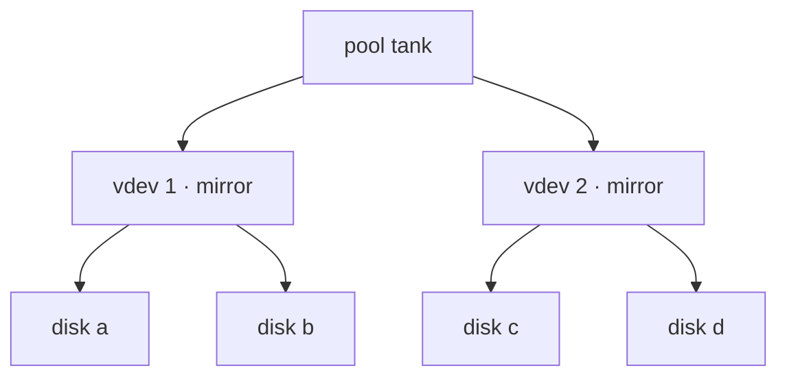

# Vdevs and mirrors

<span class="status status-draft">draft</span>

Topology, growing a pool, and why `zpool add` isn't `zpool attach`.

A pool is a striped set of vdevs. **Redundancy lives inside a vdev, never across them.**

## Topologies

| Vdev | Redundancy | Survives |
|------|-----------|----------|
| stripe | none | nothing |
| mirror, 2-way | 1 disk | 1 disk |
| mirror, 3-way | 2 disks | 2 disks |
| raidz1 | 1 disk | 1 disk |
| raidz2 | 2 disks | 2 disks |
| raidz3 | 3 disks | 3 disks |

**RAID10 is just mirrors, striped.** Two or more mirror vdevs in one pool. You get mirror read performance and mirror rebuild behaviour, striped across vdevs.



## Failure domain

A pool survives as long as **every vdev** still has enough healthy disks. Lose one vdev entirely and the pool is gone — even with the other vdev perfectly fine.

With two mirrors you can lose one disk from *each* vdev. Lose both disks of vdev 1 and nothing else matters.

## Create as RAID10

```bash
zpool create -o ashift=12 tank \
  mirror /dev/disk/by-id/ata-{A,B} \
  mirror /dev/disk/by-id/ata-{C,D}
```

Two mirror vdevs, striped. Add pairs as budget allows.

## Add another mirror

```bash
zpool add tank mirror /dev/disk/by-id/ata-{E,F}
```

## Grow an existing mirror instead

```bash
zpool attach tank /dev/disk/by-id/ata-A /dev/disk/by-id/ata-G   # 2-way -> 3-way
zpool detach tank /dev/disk/by-id/ata-G                          # 3-way -> 2-way
```

## Replace a dead disk

```bash
zpool replace tank /dev/disk/by-id/ata-OLD /dev/disk/by-id/ata-NEW
zpool status -v tank        # watch the resilver
```

## Hot spare

```bash
zpool add tank spare /dev/disk/by-id/ata-SPARE
```

Idle until a disk fails, then pulled in automatically. Worth having on a box you're not always next to.

## Gotchas

!!! warning
    `zpool add` does **not** mirror an existing disk. `zpool add tank /dev/sdX` appends a one-disk vdev — a stripe. Adding a bare disk to a mirrored pool gives you raid10's layout with a fresh single point of failure.

- **Topology is fixed after creation.** You can add vdevs; converting a stripe to a mirror means rebuilding.
- Removing a vdev is limited — mirrors and top-level vdevs only. `raidz` removal exists but is slow and newer. Treat an added vdev as permanent.
- **`raidz1` on disks over ~2 TB is a gamble.** A full resilver runs for hours to days, and a second failure in that window kills the pool. `raidz2` is the safer default at that size.
- Mixed vdev sizes waste the excess. Capacity is limited by the smallest vdev.
- Mixing mirror vdevs with raidz vdevs in one pool is legal and usually a mistake.
- Always `/dev/disk/by-id/`. `/dev/sdX` reorders on reboot and the pool comes up degraded or won't import at all.
- `zpool upgrade` writes new feature flags. Older kernels then can't import the pool.
- `zpool status -v` before and after every change. `zpool history` tells you what you did last week.

## Change log

- 2026-10-25 — first write-up
